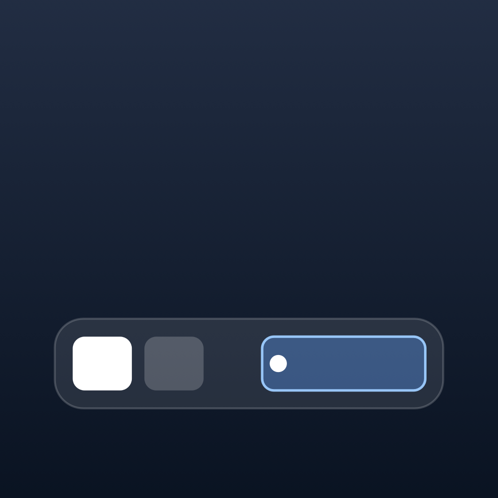

<p align="center">
  
</p>

# DockishOS

**The macOS Dock shows every app on every Space. DockishOS shows what is open on this Space.**

A SwiftUI + AppKit menu-bar utility for people who use macOS Spaces heavily.
Edge-to-edge, per-display app bar.
Scroll over the bar to switch Spaces.
Drag `.app` bundles to pin them.
Requires macOS 27 or later; [v0.028](https://github.com/8bittts/dockishOS/releases/tag/v0.028) is the last release for macOS 14, 15, and 26.
Apple Silicon, signed and notarized.

<p align="center">
  <a href="https://github.com/8bittts/dockishOS/releases/latest">
    <strong>Download the latest DMG →</strong>
  </a>
</p>

<p align="center">
  
</p>

## Why DockishOS

- **Current-Space only.** See and switch the windows that matter right now, not every app on every desktop.
- **Scroll-to-switch.** Scroll over the bar to move between Spaces without opening Mission Control.
- **Drag to pin.** Drop `.app` bundles on the bar or right-click a window chip to keep important apps close.
- **Stays out of the way.** Menu-bar accessory app with no Dock icon, and it collapses into a small edge tab.

## Install

Download the latest signed & notarized DMG, then drag DockishOS to `/Applications`:

```bash
open https://github.com/8bittts/dockishOS/releases/latest
```

Or install with [Homebrew](https://brew.sh) — the repo doubles as a Cask tap:

```bash
# One-shot install of the latest release (no tap):
brew install --cask https://raw.githubusercontent.com/8bittts/dockishOS/main/Casks/dockishos.rb

# Or tap the repo for ongoing `brew upgrade` updates:
brew tap 8bittts/dockishos https://github.com/8bittts/dockishOS
brew install --cask 8bittts/dockishos/dockishos
```

## Auto-update

Built-in via [Sparkle](https://sparkle-project.org/) with an EdDSA-signed appcast.
New releases reach existing installs automatically.

## Source

[github.com/8bittts/dockishOS](https://github.com/8bittts/dockishOS) — MIT licensed.
